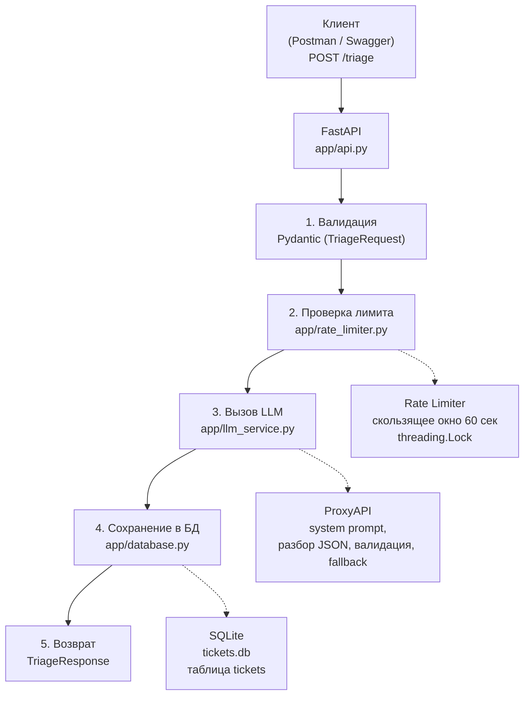

# Отчёт по практике

- **Проект:** vpk04-1-triage-ai-service
- **Автор:** Белясник Елена
- **Дата:** октябрь 2026

---

## 1. Кому и какую проблему решаем

**Кому:** онлайн-сервисам, интернет-магазинам и образовательным проектам, которые получают поток обращений от клиентов через разные каналы (email, форма на сайте, чат поддержки).

**Проблема:** менеджеры тратят время на первичную сортировку обращений и написание черновых ответов вручную. Из-за этого падает скорость реакции и качество обработки.

**Решение:** MVP-сервис, который автоматически:

- классифицирует обращение по типу (`billing`, `support`, `complaint`, `other`);
- готовит черновик ответа клиенту;
- оценивает уверенность модели (`high`, `medium`, `low`);
- решает, нужно ли передать обращение человеку (`escalate`);
- сохраняет историю обработки в БД для аудита.

---

## 2. Ограничения и допущения

| Параметр | Значение |
|---|---|
| Максимальная длина текста | 2000 символов (валидация Pydantic) |
| Обязательные поля | `text`, `channel`, `client_id` |
| Допустимые каналы | `email`, `form`, `chat` |
| Лимит запросов | 5 запросов в минуту на `client_id` (настраивается через `.env`) |
| Окно лимитирования | 60 секунд (настраивается через `RATE_WINDOW_SECONDS`) |
| Хранилище | SQLite, одна таблица `tickets` |
| Безопасность | Ключ LLM только в `.env`, не в коде |
| Развёртывание | Локальное (путь B), без платного сервера |
| Без RAG / базы знаний | Следующий этап |
| Максимум 4 категории | `billing`, `support`, `complaint`, `other` |

---

## 3. Архитектура

### 3.1. Схема потока обработки



### 3.2. Слои проекта

| Слой | Файл | Назначение |
|---|---|---|
| Конфигурация | `app/config.py` | Чтение настроек из `.env` |
| Контракт | `app/models.py` | Pydantic-модели `TriageRequest` / `TriageResponse` |
| API | `app/api.py` | Эндпоинт `POST /triage`: валидация, лимит, вызов LLM, сохранение, ответ |
| LLM | `app/llm_service.py` | Обращение к ProxyAPI, системный промпт, разбор и валидация JSON, fallback |
| Лимитирование | `app/rate_limiter.py` | Скользящее окно на `client_id` |
| БД | `app/database.py` | SQLite: `init_db`, `save_ticket`, `get_ticket` |
| Логирование | `app/logger.py` | Консоль + `logs/app.log` (`LOG_LEVEL`, `LOG_MODE`) |
| Точка входа | `main.py` | FastAPI-приложение, `lifespan` (init_db), роутер |

---

## 4. Контракт программного интерфейса

### 4.1. Вход — `POST /triage`

```json
{
  "text": "Не приходит счёт за услуги",
  "channel": "email",
  "client_id": "client-001"
}
```

### 4.2. Выход — `200 OK`

```json
{
  "category": "billing",
  "draft_reply": "Здравствуйте! Проверьте, пожалуйста, корректность адреса доставки счетов в личном кабинете. Мы сверим начисления за текущий период и свяжемся с вами в течение рабочего дня.",
  "confidence": "high",
  "escalate": false
}
```

### 4.3. Ошибки

| Код | Когда | Тело ответа |
|---|---|---|
| `422` | Невалидные данные (нет `text`, неверный `channel`, пустой `client_id`, текст > 2000) | `{"detail": [...]}` |
| `429` | Превышен лимит запросов | `{"error": "rate_limit_exceeded", "detail": "Слишком много запросов. Попробуйте через минуту."}` |

---

## 5. Как устроен журнал обработки

Таблица `tickets` (SQLite, файл `tickets.db`):

| Поле | Тип | Описание |
|---|---|---|
| `id` | INTEGER PK AUTOINCREMENT | Уникальный ID |
| `created_at` | TIMESTAMP | Дата и время (SQLite подставляет сам) |
| `client_id` | TEXT | ID клиента |
| `channel` | TEXT | Канал (`email` / `form` / `chat`) |
| `text` | TEXT | Текст обращения |
| `category` | TEXT | Категория (`billing` / `support` / `complaint` / `other`) |
| `confidence` | TEXT | Уверенность (`high` / `medium` / `low`) |
| `escalate` | INTEGER | `0` / `1` (передать человеку) |
| `draft_reply` | TEXT | Черновик ответа |
| `error` | TEXT | Причина сбоя LLM (`NULL` при успехе) |

- Записывается **каждое** обращение — и успешное, и fallback.
- Все SQL-запросы параметризованы (`?`) — текст обращения не может стать SQL-командой.
- Ошибка записи в БД **не меняет ответ клиенту**: запрос остаётся `200`, в лог уходит `ERROR`.

---

## 6. Надёжность

### 6.1. Fallback при ошибке LLM

Если LLM недоступна или вернула некорректный ответ, эндпоинт не падает, а возвращает безопасный ответ:

```json
{
  "category": "other",
  "draft_reply": "Обращение передано оператору.",
  "confidence": "low",
  "escalate": true
}
```

Fallback срабатывает при:

- сетевой ошибке / таймауте;
- ошибочном статусе провайдера (`401`, `429`, `5xx`);
- ответе, из которого не удалось извлечь JSON;
- недопустимых значениях полей (`category` вне списка, `confidence` вне списка, `escalate` не `bool`, пустой `draft_reply`).

Причина сбоя пишется в лог уровнем `WARNING` / `ERROR` и сохраняется в БД — в колонку `error`.

### 6.2. Лимитирование

- 5 запросов в минуту на `client_id` (`RATE_LIMIT_PER_MINUTE` в `.env`).
- Скользящее окно 60 секунд (`RATE_WINDOW_SECONDS`).
- Потокобезопасно — словарь под `threading.Lock`.
- Счётчики для разных `client_id` независимы.
- При превышении — `429` + `WARNING` в лог.

### 6.3. Логирование

- Фиксируются все этапы: запрос, ответ LLM, запись в БД, ошибки.
- Логи пишутся в консоль и в `logs/app.log`.
- Текст обращения в лог **не попадает** (персональные данные) — только длина и канал.
- Режим лога настраивается: `LOG_MODE=write` (пересоздавать) / `append` (накапливать).

---

## 7. Развёртывание / демонстрация

Выбран **Путь B** — локальный запуск + демо-видео.

### Запуск

```bash
# 1. Создать виртуальное окружение
python -m venv venv
venv\Scripts\activate          # Windows
# source venv/bin/activate     # Linux/macOS

# 2. Установить зависимости
pip install -r requirements.txt

# 3. Создать .env из .env.example и заполнить ключи
copy .env.example .env         # Windows
# cp .env.example .env         # Linux/macOS

# 4. Запустить сервис
uvicorn main:app --reload
```

Проверка: Swagger UI — http://localhost:8000/docs

---

## 8. Демонстрация

<!-- ЗАПОЛНИТЬ ПОСЛЕ ЗАПИСИ ВИДЕО: вставить ссылку на демо-видео -->

Демо-видео (2–3 минуты): [**смотреть видео**](https://www.loom.com/share/0045319f3971487c9db2e9082907fc2c)

Сценарий записи:

1. Запуск сервиса (`uvicorn main:app --reload`).
2. Открытие Swagger UI (`http://localhost:8000/docs`).
3. Отправка `POST /triage` с валидными данными → `200`, ответ модели.
4. Открытие `tickets.db` в DBeaver → появляется новая запись.
5. Открытие `logs/app.log` → видно записи о запросе и ответе.
6. Отправка 6 запросов с одним `client_id` → 6-й получает `429`.
7. Отправка запроса с другим `client_id` → `200` (лимиты независимы).

---

## 9. Что улучшить в v2

| Направление | Что добавить |
|---|---|
| RAG | Подключить базу знаний (документация компании, FAQ) |
| Мониторинг | Метрики: количество обращений, среднее время ответа, доля fallback |
| Админка | Веб-интерфейс для просмотра `tickets`, статистики, ручной обработки |
| Аутентификация | API-ключи для клиентов, чтобы не спамили |
| Категории | Добавить больше категорий (доставка, возврат, техподдержка) |
| Мультиязычность | Автоопределение языка обращения |
| Хранение лимитов | Redis вместо in-memory (чтобы лимиты сохранялись между перезапусками) |
| Деплой | Бесплатный хостинг (Render, Railway) с публичной ссылкой |

---

## 10. Лог откликов (30 шт., летний режим)

Лог откликов ведётся в отдельном файле: **[`responses_log.csv`](responses_log.csv)**.

В таблице 30 строк — по числу откликов в летнем режиме (60 × 50%, период 15.05–15.09).

Колонки: №, дата, площадка, ссылка на заказ, тема заказа, текст отклика, фокус (A/B), статус, комментарий.

---

*Конец отчёта.*